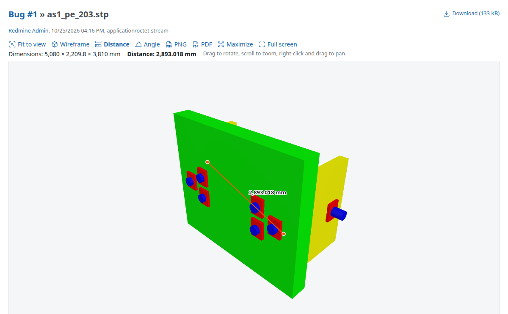
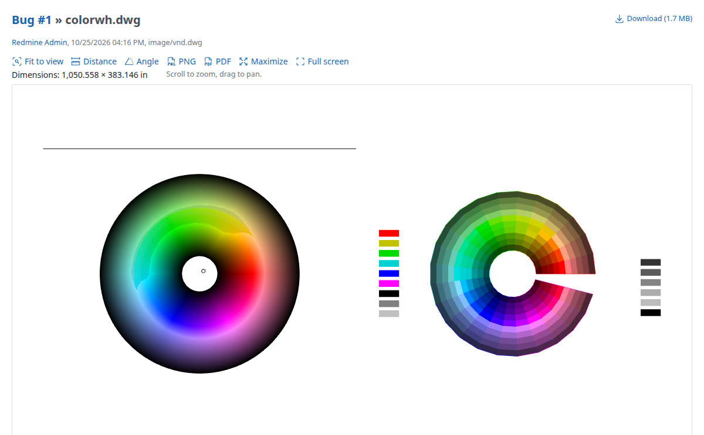

# Redmine CAD Preview Plugin

[](https://github.com/flowalchs/redmine_cad_preview/actions/workflows/build.yml)
[](https://github.com/flowalchs/redmine_cad_preview/releases/latest)
[](https://www.redmine.org/plugins/redmine_cad_preview)
[](https://www.redmine.org)
[](https://codecov.io/gh/flowalchs/redmine_cad_preview)

This plugin shows CAD attachments directly in Redmine: 3D models can be rotated, zoomed and panned, 2D drawings can be zoomed and panned. Instead of "No preview available", the attachment page shows an interactive viewer for issues, documents, files and wiki pages.

## 🧠 How it works

- **In the browser**: The files are displayed by a viewer that runs in the browser (three.js, OpenCASCADE as WebAssembly, dxf-viewer). The libraries are included in the plugin, so no internet access is needed.
- **Files stay in Redmine**: The browser loads the file from Redmine with the same permissions as a download. No file is sent to a third party.
- **DWG on the server**: DWG files are converted to DXF on the server with [LibreDWG](https://www.gnu.org/software/libredwg/). The conversion runs in the background right after the upload, so the preview is ready when it is opened.
- **Thumbnails**: The thumbnails in the attachment lists are made from the image of the default view, if the attachment has one. Otherwise they are made from the image that CAD programs save in the file (Inventor, Solid Edge, SolidWorks, FreeCAD, 3MF, DXF, DWG). For files without image, the browser sends a snapshot of the viewer when the preview is opened for the first time by a user who can edit the attachment.
- **Saved views**: The views are stored in the database, their images as attachments of the views in the `files` directory of Redmine.

## 🌟 Features

- **3D preview** – STEP (.step, .stp), IGES (.iges, .igs), BREP (.brep, .brp), FreeCAD (.FCStd), STL, OBJ, 3MF, glTF (.gltf, .glb), PLY, Collada (.dae), FBX, VRML (.wrl, .vrml), AMF, 3DS
- **2D preview** – DXF, and DWG converted to DXF
- **Autodesk Inventor** (.ipt, .iam, .ipn, .idw, .ide), **Solid Edge** (.par, .asm, .psm, .pwd, .dft) and **SolidWorks** (.sldprt, .sldasm, .slddrw) – Shows the preview image that these programs save in the file
- **Thumbnails** – CAD attachments get thumbnails in the attachment lists, like images (with ImageMagick, if thumbnails are enabled in the Redmine settings)
- **File icons** – 3D models and 2D drawings get their own icons in the attachment lists, from Redmine 7.0 (which shows file type icons there). Redmine 7.0 only passes the content type, so only files with a CAD content type get the icons there, e.g. DWG, DXF, STL and IGES. Redmine trunk also passes the filename, so all CAD files get the icons. Icons of the theme are used first.
- **Viewer controls** – Rotate, zoom, pan, fit to view, wireframe
- **World axes** – A small X (red), Y (green), Z (blue) orientation indicator in the lower-right corner of 3D views. Visible by default; toggle **World axes** to hide it. Its visibility is saved with the view and respected in PNG/PDF downloads and saved images. The indicator is added after cropping saved images, without retaining empty viewport margins.
- **Parts of assemblies** – STEP, IGES and BREP files with several parts show their product tree in a panel: parts and assemblies can be shown and hidden, and clicking a name shows only this part and fits the view to it. The hidden parts are saved with the view.
- **Colors** – The colors of the bodies and of single faces of STEP models are shown
- **Section view** – 3D models can be cut along the X, Y or Z axis, with closed cut faces. The plane is moved with a slider or with the arrow in the view, and can be flipped. The section is saved with the view and shown in the PNG and PDF downloads and in the images of the views.
- **Saved views** – Save the current view (camera, material, lighting, wireframe, hidden parts, section) under a name, e.g. `front` or `detail`, and restore it from the toolbar. The default view of an attachment is restored when the preview is opened, and its image is the thumbnail of the attachment. Each view is saved with an image without background, cropped to the model or drawing. For 3D models and 2D drawings, in issues, documents, files, wiki pages and news.
- **Material and lighting** – 3D models can be shown with their original or with matte materials, and with the original lighting or studio lighting. The studio lighting adds reflections, so that metallic models (e.g. glTF) are not displayed dark. The file is not changed.
- **Measuring** – Overall dimensions of the model or drawing, distance between two points and angle between three points (without snapping). The unit is taken from the file where it is known (STEP, IGES, BREP: mm, glTF: m, DXF: `$INSUNITS`).
- **Macro** – Shows the viewer of an attachment in wiki pages, issues, documents and news, with a saved view, all saved views, or the images of the views (see [Macro](#-macro))
- **Download of the current view** – As PNG image or PDF (A4) with the measurement, the file name and the dimensions. Created in the browser, without an additional library. The file name contains the name of the saved view if the view has not been changed.
- **Maximize and full screen** – Maximize the viewer to the browser window (remembered in the browser) or switch to full screen
- **Background conversion of DWG files** – Started after the upload. A failed conversion is attempted at most twice, so opening the preview does not start a new conversion every time.
- **Settings** – Previewed formats, maximum file size, default material and lighting, DWG conversion timeout
- **API for other plugins** – Other plugins can set the material and lighting of an attachment, read and save the views of attachments in Ruby or with the REST API, and save and restore the view of the viewer in JavaScript (see [API for other plugins](#-api-for-other-plugins))
- **No additional gems**

## 📸 Screenshots

| 3D model (STEP) with a distance measurement | 2D drawing (DWG) |
| --- | --- |
| [](docs/screenshot-3d.png) | [](docs/screenshot-2d.png) |

## ⚙️ Plugin Configuration

Configure the plugin under **Administration → Plugins → Redmine CAD Preview → Configure**:

| Setting                       | Description                                                                 |
| ----------------------------- | --------------------------------------------------------------------------- |
| Previewed formats             | Formats shown in the viewer (default: all)                                  |
| Maximum file size             | Larger files are not previewed (default: 50 MB). The file is loaded and converted to triangles in the browser, which needs a multiple of the file size in memory. On the server, the file is sent like a download, so the limit only matters for the DWG conversion, which runs as a separate process. |
| Material                      | Material of 3D models when the preview is opened: original or matte (default: original) |
| Lighting                      | Lighting of 3D models when the preview is opened: original or studio (default: original) |
| Conversion timeout            | Maximum time of a DWG conversion in seconds (default: 30)                   |

The command of the DWG converter is not a plugin setting, so that it cannot be changed in the browser. Like the commands of ImageMagick, Ghostscript and Pandoc, it can be set in `config/configuration.yml` of Redmine. Without it, `dwg2dxf` is found in the `PATH` of Redmine:

```yaml
default:
  # Absolute path (e.g. /usr/local/bin/dwg2dxf) to the `dwg2dxf` command
  # of LibreDWG. Used to convert DWG files for the CAD preview.
  #dwg2dxf_command:
```

Restart Redmine after changing it. The settings page shows whether the DWG converter is available. Without it, DWG files are not previewed, and all other formats still work.

## 📝 Macro

The macro `cad_preview` shows the viewer of a CAD attachment in wiki pages, issues, notes, documents, news and other texts:

```
{{cad_preview(model.step)}}
{{cad_preview(123, view=front, height=420)}}
{{cad_preview(model.step, view=*)}}
{{cad_preview(model.step, view=front, png)}}
{{cad_preview(model.step, view=front, readonly)}}
```

| Parameter | Description |
| --- | --- |
| attachment | File name of an attachment of the page, issue or document (like the `thumbnail` macro of Redmine), or the ID of any attachment |
| `view=name` | The saved view with this name. Without `view`, the default view is shown, or the whole model if the attachment has no default view. A view that does not exist shows an error, it is not replaced by another view. |
| `view=*` | All saved views of the attachment, one below the other |
| `height=520` | Height of the viewer in pixels, from 240 to 1200 (default: 520). With `png`, the maximum height of the images, from 16 to 1200. |
| `png` | The images of the views instead of the viewer, without JavaScript. Without default view, the thumbnail of the attachment is shown. |
| `readonly` | The viewer without the controls to save, delete and set views, also for users with the permissions. The views can still be restored. For viewers that show a temporary state, which should not replace a prepared view. |

The viewer in the macro has the same toolbar as the preview of the attachment, with icons only. The views can be restored and, with the permissions, saved and deleted. The viewers are loaded when they become visible, so that a page with many viewers does not load all files at once.

When `{{cad_preview(` is typed in a text field, the CAD attachments of the issue, wiki page, document, news or message are suggested, together with the CAD files uploaded in the form. Enter closes the macro, Tab adds the next argument: the options `view=`, `height=` and `png` are suggested, then the saved views of the file and some heights (Redmine 6.1 and later, which provide Stimulus).

In the PDF export of issues and wiki pages, in emails and in Atom feeds, the macro shows the images of the views, as no viewer can be shown there. Without default view, it shows the thumbnail of the attachment (the image saved in the file or the snapshot of the viewer). The attachment must be visible to the user, otherwise the macro shows an error.

## 🔐 Permissions

The views of an attachment can be seen and restored by all users who can see the attachment. Saving, changing and deleting views needs one of these permissions of the roles (**Administration → Roles and permissions**, section "Project"):

| Permission | Description |
| --- | --- |
| Save views of own CAD attachments | Views of the attachments the user has added |
| Save views of all CAD attachments | Views of all attachments the user can see |

## 📐 DWG conversion with LibreDWG

LibreDWG is installed separately on the server. It is not included in the plugin. On Ubuntu 24.04, there is no package for it, so it is built from source:

```bash
sudo apt-get install build-essential
curl -LO https://ftp.gnu.org/gnu/libredwg/libredwg-0.14.tar.xz
tar xf libredwg-0.14.tar.xz
cd libredwg-0.14
./configure --prefix=/usr/local --disable-bindings --disable-python --disable-docs
make -j"$(nproc)"
sudo make install
sudo ldconfig
dwg2dxf --version
```

The converted files and the images for the thumbnails are stored in `files/derived_cache/cad_previews` and deleted together with the attachment.

The conversion runs as an Active Job. With the default queue adapter of Redmine, it runs in the background of the Redmine process.

## ⚠️ Limitations

- **DWG**: LibreDWG reads older DWG versions well. Newer DWG versions (2018 and later) are only partly supported, e.g. some texts may be missing.
- **3D solids in DXF and DWG**: 3D solids (ACIS data, e.g. `3DSOLID`) cannot be displayed. The preview shows a notice, and for drawings made of 3D solids the image saved in the file.
- **glTF**: `.gltf` files that reference external `.bin` or texture files are not supported. Use `.glb` instead.
- **FreeCAD**: The visible objects of the document are shown, with their color. Documents with only 2D objects (sketches, wires) cannot be displayed.
- **Textures and animations**: Textures in separate files (e.g. of OBJ, FBX, Collada and 3DS files) are not loaded, only the colors of the materials are shown. Animated models are shown in their rest pose.
- **Large models**: STEP and IGES files are converted to triangles in the browser. Very large models can take a while and need a lot of memory.
- **Measuring**: Points are picked on the surface of the model or anywhere in the drawing, without snapping to edges or end points. STL, OBJ and 3MF files have no unit, so measurements are shown in "units".
- **Autodesk Inventor, Solid Edge and SolidWorks**: Only the preview image saved in the file is shown, the model itself cannot be read without these programs. Export the model as STEP to view it in 3D. The image is the view of the last save.
- **.asm files** are only treated as Solid Edge assemblies if they are OLE compound files, so that assembler source files are not affected.
- **Saved views** belong to the attachment, so the same file attached twice has its own views each time. When an issue or a project is copied, the attachments are copied without their views.

## 📋 Requirements

- **Redmine**: 6.0 or higher
- **Ruby**: as required by your Redmine version (tested with 3.2 – 4.0)
- **Database**: MySQL or PostgreSQL
- **Browser**: with WebGL and WebAssembly support (all current browsers)
- **Optional**: LibreDWG for the preview of DWG files

## 🚀 Installation

```bash
cd $REDMINE_ROOT/plugins
git clone https://github.com/flowalchs/redmine_cad_preview.git
```
Run the database migration of the plugin and restart your Redmine server. No `bundle install` is needed, as the plugin has no Gemfile.

```bash
cd $REDMINE_ROOT
bundle exec rake redmine:plugins:migrate NAME=redmine_cad_preview RAILS_ENV=production
```

## 🔌 API for other plugins

### Material and lighting of an attachment

Other plugins can set the material and lighting when the preview of an attachment is opened. The provider is called with the attachment and returns the options, which override the plugin settings:

```ruby
RedmineCadPreview::ViewerOptions.register(:my_plugin) do |attachment|
  {'material_mode' => 'matte', 'lighting' => 'studio'}
end
```

`material_mode` can be `original` or `matte`, `lighting` can be `original` or `studio`. Other keys and values are ignored. Register the provider in `after_plugins_loaded`, as this plugin can be loaded after yours.

### Saved views in Ruby

```ruby
view = RedmineCadPreview::Views.find(attachment, 'front')  # or Views.default(attachment), Views.all(attachment)
view.state           # the state of the viewer (Hash, see exportView below)
view.image.diskfile  # the PNG image of the view
view.revision        # increased each time the view is saved
view.stale?          # true if the attachment has changed since the view was saved
```

`Views.save(attachment, name, user:, revision:, state:, image:, is_default:)` saves a view and `Views.delete(attachment, name, revision:)` deletes it. The revision that was read is needed to change a view, otherwise `RedmineCadPreview::Views::Conflict` is raised. The permissions are not checked by these methods; `CadPreviewView.editable?(attachment, user)` tells whether a user can save views.

### Saved views with the REST API

With the REST API enabled (**Administration → Settings → API**) and an API key, like the API of Redmine:

| Request | Description |
| --- | --- |
| `GET /cad_previews/:id/views.json` | Views of the attachment with name, default, revision, stale, state, image (id and `content_url`) and user |
| `GET /cad_previews/:id/views/:name.json` | One view |
| `PUT /cad_previews/:id/views/:name.json` | Saves a view: `{"view": {"state": {...}, "image": "<PNG, Base64 encoded>", "is_default": true, "revision": 3}}`. A new view needs the state and the image, an existing view the revision that was read. |
| `DELETE /cad_previews/:id/views/:name.json?revision=3` | Deletes a view |

A view that was changed or deleted in the meantime returns `409 Conflict`. The image is at most 1600 × 1600 pixels and is downloaded with the attachments API of Redmine (`content_url`). The viewer uses the same URLs without `.json` with the session of the user, so it does not need the REST API.

### JavaScript

When the viewer has loaded the file, it sets `element.cadViewer` on the `[data-cad-preview]` element and dispatches the `cad-preview:ready` event (bubbling, with the viewer in `event.detail.viewer`). If the file cannot be loaded, it sets `element.cadError` and dispatches `cad-preview:error`.

```js
document.addEventListener('cad-preview:ready', (event) => {
  const viewer = event.detail.viewer;
  const state = viewer.exportView();
  // ...
  viewer.restoreView(state);
});
```

| Method | Description |
| --- | --- |
| `exportView()` | Returns the current view as an object that can be saved as JSON. 3D models: camera (position, target, up, zoom, clipping planes), projection, viewport aspect, material, lighting, wireframe and background, `section` with the axis, position and direction of the section view (only if the model is cut, e.g. `{"axis": "z", "position": 12.5, "flip": false}`), and `hidden` with the paths of the hidden parts (only if parts are hidden, e.g. `["as1/l-bracket-assembly#2"]`: the names from the model to the part, siblings with the same name numbered). Drawings: `projection: 'drawing'`, center, width of the view and viewport aspect. The object has `version: 1`. |
| `restoreView(state)` | Restores a view returned by `exportView()`. The viewport should have the saved aspect, otherwise the view is cut or extended. |
| `setProjection(mode)` | 3D models only: `'perspective'` (default) or `'orthographic'` |
| `setAxesVisible(visible)` | Shows or hides the world-axis indicator in 3D views; `exportView()` includes its boolean `axes` state. Older views without this field show the axes. |
| `drawAxes(context, width, height, pixelRatio = 1)` | Composites the visible indicator onto a 2D canvas, e.g. after cropping a custom image. `getRenderContext().canvas` contains only the model. |
| `getRenderContext()` | Returns `canvas`, `renderer`, `scene` (`null` for drawings) and `render()`, e.g. to create an image of the view |

The canvas has an alpha channel, so a plugin can remove the background (`scene.background = null`) to create images without background.

## 🧪 Tests

```bash
cd $REDMINE_ROOT
bundle exec rake redmine:plugins:test NAME=redmine_cad_preview RAILS_ENV=test
```

With `COVERAGE=1`, a coverage report is created in `coverage/` (with `simplecov` of Redmine). The Cobertura report for Codecov is created only if `simplecov-cobertura` is installed, e.g. with `gem 'simplecov-cobertura'` in Redmine's `Gemfile.local`.

The tests of the viewer in `frontend/test` run with Node.js and without WebGL (`cd frontend && npm test`).

The tests use a stand-in for `dwg2dxf` (`test/support/fake_dwg2dxf`), so LibreDWG is not needed to run them. The test files with images are built with `test/support/build_fixtures.rb`.

## 🛠️ Development

The viewer is built from the sources in `frontend/` into `assets/`. The built files are included in the repository and in the release, so users do not need Node.js.

```bash
cd frontend
npm ci
npm test
npm run build
```

### Included JavaScript libraries

The versions are pinned in `frontend/package.json` (exact versions) and `frontend/package-lock.json`:

| Package | Used for | Included in the build |
| --- | --- | --- |
| `three` | 3D viewer, loaders for STL, OBJ, 3MF and glTF, studio lighting | `assets/javascripts/cad_preview.js` |
| `occt-import-js` | Reading STEP, IGES and BREP (WebAssembly), in a worker (`assets/javascripts/cad_preview_occt_worker.js`) | `assets/javascripts/occt-import-js.{js,wasm}` |
| `@hotwired/stimulus` | Suggestions of file names for the macro, provided by Redmine (not included) | `assets/javascripts/cad_preview_autocomplete.js` |
| `dxf-viewer` | DXF viewer (with `opentype.js`, `earcut`, `loglevel`) | `assets/javascripts/cad_preview.js`, `assets/javascripts/cad_preview_dxf_worker.js` (parsing in a worker) |
| `@fontsource/noto-sans` | Font for texts in DXF drawings | `assets/fonts/` |
| `@tabler/icons` | Toolbar and file icons | `assets/images/icons.svg` |
| `esbuild` | Bundler (only for the build) | – |

Dependabot checks the libraries once a month and opens a pull request with the updates. The workflow `frontend.yml` rebuilds the viewer in this pull request and updates the versions in [THIRD_PARTY_NOTICES.md](THIRD_PARTY_NOTICES.md). Before merging:

1. Check the license texts in `licenses/` if a license changed.
2. Check the preview of all formats, as `dxf-viewer` is used with a patch of its parser (counting 3D solids, see `frontend/src/dxf_solids.js`).

To update a library by hand, change the version in `package.json`, then run `npm install`, `npm run build` and `node notices.mjs --write`. Other pull requests that change `frontend/` must contain the rebuilt files, which `frontend.yml` checks.

## ❌ Uninstall

Revert the database migration of the plugin, which deletes the saved views with their images and the converted DWG files and images in `files/derived_cache/cad_previews`:

```bash
cd $REDMINE_ROOT
bundle exec rake redmine:plugins:migrate NAME=redmine_cad_preview VERSION=0 RAILS_ENV=production
```

Then remove the directory `plugins/redmine_cad_preview` and restart your Redmine server.

## 📜 License

MIT License. The included third-party libraries have their own licenses, see [THIRD_PARTY_NOTICES.md](THIRD_PARTY_NOTICES.md).
